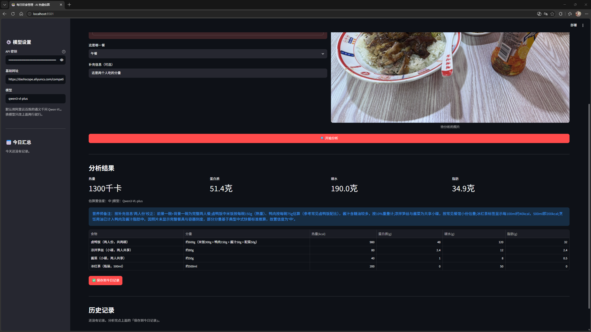

# 🥗 每日饮食管理 · AI 热量估算

拍一张饭的照片，用多模态大模型识别菜品、估算分量，返回**热量 / 蛋白质 / 碳水 / 脂肪**，并自动汇总成每日记录。

> 我做这个项目的起因很简单：想知道自己每天到底吃进去多少，但一个个查食物成分表太麻烦了。
> 拍照是最省事的输入方式。



> ⬆️ 把你的截图放到 `docs/demo.png`（没有 `docs` 文件夹就新建一个）。

---

## 功能

- **拍照或上传**一张食物照片
- 大模型**识别所有菜品**，估算每一道的分量（约 xxx g / ml）
- 输出每一道的**热量、蛋白质、碳水、脂肪**，并给出合计
- 给出**估算置信度**和**营养师备注**（说明它做了哪些假设）
- **一键存进当天记录**，自动汇总今日摄入
- **导出 CSV**，方便后续分析

## 第 0 步：先装 Python 和 Git

**这两个必须装，而且要在开始之前装。**

- **Python 3.10+**：https://www.python.org/downloads/
  安装时**务必勾选最下面那个「Add python.exe to PATH」**——不勾的话命令行里找不到 `python`。这一步是新手最常踩的坑。
- **Git**：https://git-scm.com/download/win
  一路默认下一步即可。或者装 [GitHub Desktop](https://desktop.github.com/)，它自带 Git 且有图形界面。

> **Windows 上的一个陷阱**：如果你在命令行输入 `python` 却弹出微软应用商店，说明你**没装 Python**，PATH 里那个是系统的占位程序。
> 用 `python --version` 验证，能打印出版本号才算装好。

## 怎么运行（本地）

```bash
# 1. 拿到代码
git clone https://github.com/你的用户名/daily-diet.git
cd daily-diet

# 2. 装依赖（建议用虚拟环境）
python -m venv .venv
.venv\Scripts\activate        # Windows
# source .venv/bin/activate   # macOS / Linux
pip install -r requirements.txt

# 3. 配置 API Key
copy .env.example .env        # Windows
# cp .env.example .env        # macOS / Linux
# 然后打开 .env，把 LLM_API_KEY 换成你自己的

# 4. 启动（注意用 python -m，见下方常见问题 7）
python -m streamlit run app.py
```

浏览器会自动打开 `http://localhost:8501`。

> **嫌敲命令麻烦，可以直接双击项目里的 `start.bat`**，它会自动切到项目目录再启动。
>
> ⚠️ **这个终端窗口要一直开着。** 关掉窗口 = 程序停止，网页就打不开了。想停就按 `Ctrl+C`。
>
> 只想重新打开网页（程序还在跑）：直接访问 `http://localhost:8501`，不用重启。

### 怎么拿 API Key

默认用的是**阿里云百炼（通义千问 Qwen-VL）**，国内可直接访问，新用户有免费额度：

1. 打开 https://bailian.console.aliyun.com/
2. 开通服务，在「API-KEY 管理」里创建一个 key
3. 填进 `.env` 的 `LLM_API_KEY`

## 怎么部署到网上（这一步很重要）

面试官不会去 clone 你的代码本地跑，他只会点链接。所以一定要部署。

1. 把代码 push 到 GitHub
2. 打开 https://share.streamlit.io/ ，用 GitHub 账号登录
3. 选择你的仓库，**Main file path 填 `app.py`**
4. 点 `Advanced settings` → `Secrets`，把 `.streamlit/secrets.toml.example` 里的三行粘进去（换成你自己的 key）
5. 部署完，你会得到一个 `https://xxx.streamlit.app` 的链接

**把那个链接写在简历和 README 最上面。**

## 换成别的模型

代码用的是 OpenAI 兼容接口，所以换模型只需要改 `.env` 里两行：

| 服务商 | LLM_BASE_URL | LLM_MODEL |
|---|---|---|
| 阿里云百炼（默认） | `https://dashscope.aliyuncs.com/compatible-mode/v1` | `qwen3-vl-plus` |
| 智谱 GLM | `https://open.bigmodel.cn/api/paas/v4` | `glm-4v-plus` |
| OpenAI | `https://api.openai.com/v1` | `gpt-4o-mini` |

百炼的视觉模型还有两个可选：`qwen3-vl-flash`（更便宜更快，估算粗一点）、`qwen-vl-max`（更准更贵）。完整列表见[官方文档](https://help.aliyun.com/zh/model-studio/model-list-visual-understanding/)。

## 项目结构

```
daily-diet/
├── app.py                          # Streamlit 界面：上传、展示、记录
├── analyzer.py                     # 核心逻辑：压缩图片 → 调模型 → 解析 JSON
├── test_analyzer.py                # 单元测试（不需要联网、不需要 API Key）
├── requirements.txt
├── .env.example                    # 配置模板（真正的 .env 不提交）
├── .gitignore                      # 挡住 .env，防止 key 泄露
├── .streamlit/
│   └── secrets.toml.example        # 云端部署用的配置模板
└── README.md
```

## 测试

```bash
pytest -q
# 或者不装 pytest 也行：
python test_analyzer.py
```

这 6 个测试全部不需要联网、不需要 API Key——因为模型返回的 JSON 被我 mock 成了文本，测的是**解析和清洗逻辑**，而不是模型本身。

## 我是怎么做的（写给面试官）

<!-- 这一段最值钱，一定要自己写。写你真实遇到的问题和解决过程。 -->

- **图片为什么要压缩**：原图经常好几 MB，直接发给模型又慢又费 token。所以在 `analyzer.py` 里用 Pillow 把长边压到 1024px，实测对估算精度基本没影响，速度快了很多。
- **模型返回的不是干净 JSON**：它有时候会用 markdown 代码块包起来，有时候前面还加一句"好的，我来分析"。所以写了 `_extract_json()` 做容错，把代码块和多余文字剥掉再解析。
- **合计不用模型给的**：一开始直接用模型返回的 total，发现有几次和明细对不上。后来改成自己按明细重算合计，保证数据一致。
- **字符串数字——这是测试抓出来的 bug**：我原本以为模型只会返回 `232` 这种数字，写了 `float(value)` 就完事。结果写测试的时候顺手测了一下 `"约560"`，直接变成 0，一整道菜的热量就凭空消失了。改成先用正则从字符串里抠出第一个数字，`"约560"`、`"560 kcal"`、`"≈18.5"` 都能正确处理。**如果我当时没写这个测试，这个 bug 大概会一直留到线上，而且很难发现——因为页面只会显示一个偏低的数字，不会报错。**

## 已知的限制

- **照片估算天生是粗的。** 同一盘菜，从不同角度看分量能差 30% 以上。所以结果只适合做趋势参考，不适合当医学或健身的精确依据。
- **中餐混合菜很难拆。** 比如鱼香肉丝，里面的肉、木耳、胡萝卜、油各占多少，模型只能猜。
- **记录存在会话里**，刷新页面会清空。要长期保存得接数据库，或者先导出 CSV。
- 烹饪用油的热量容易被低估，这是目前最大的误差来源。

## 可以继续做的方向

- [ ] 接数据库（Supabase 免费版），记录不再丢
- [ ] 每日目标设定 + 进度条（比如 1800 kcal / 蛋白质 100g）
- [ ] 一周趋势图：热量曲线、三大营养素占比饼图
- [ ] 连拍多张自动合并成一餐
- [ ] 根据当天摄入生成饮食建议（再加一次文字模型调用就行）

## 常见问题（都是真踩过的坑）

### 1. `python` 一输就弹出微软应用商店

说明**你其实没装 Python**。PATH 里那个 `python.exe` 是 Windows 的占位程序，它会把你导到应用商店。
去 https://www.python.org/downloads/ 重装，**务必勾选「Add python.exe to PATH」**。

### 2. `.venv\Scripts\activate` 报「因为在此系统上禁止运行脚本」

这是 Windows 的执行策略拦住了 `.ps1` 脚本，和你的代码无关。三个办法，任选一个：

**办法 A（推荐）：不用虚拟环境，直接装到用户目录**

```powershell
python -m pip install -r requirements.txt
python -m streamlit run app.py
```

**办法 B：用虚拟环境，但不激活它**——直接调用里面的 python，绕开激活脚本

```powershell
.venv\Scripts\python.exe -m pip install -r requirements.txt
.venv\Scripts\python.exe -m streamlit run app.py
```

**办法 C：放开当前用户的执行策略**

```powershell
Set-ExecutionPolicy -Scope CurrentUser RemoteSigned
```

之后 `.venv\Scripts\activate` 就能用了。

### 3. 出现 `Defaulting to user installation because normal site-packages is not writeable`

说明**虚拟环境没有被激活**——多半是激活失败了（见上一条），所以你后面的 `pip install` 装到了用户目录，而不是虚拟环境里。

不算致命，但两条路别混着走，否则会出现「明明装了却 import 不到」。**选一条走到底。**

### 4. 报「没有找到 API Key」

按顺序检查：

1. `.env` 是不是和 `app.py` 在**同一个文件夹**里
2. 记事本另存时「保存类型」有没有选**「所有文件」**——否则会存成 `.env.txt`，程序读不到
   （资源管理器里打开「文件扩展名」就能看出来）
3. `LLM_API_KEY=` 后面有没有夹到空格或引号

在项目目录里跑这条可以立刻验证：

```powershell
python -c "from dotenv import load_dotenv; import os; load_dotenv(); k=os.getenv('LLM_API_KEY',''); print('读到 key:', k[:8]+'...' if k else '没读到！')"
```

### 5. 报 401 或 403

**地域不匹配。** 百炼控制台右上角选的哪个地域，Base URL 就得配套：

| 控制台地域 | LLM_BASE_URL |
|---|---|
| 华北2（北京）等国内地域 | `https://dashscope.aliyuncs.com/compatible-mode/v1` |
| 新加坡 | `https://dashscope-intl.aliyuncs.com/compatible-mode/v1` |

### 6. 报模型不存在

去[视觉理解模型列表](https://help.aliyun.com/zh/model-studio/model-list-visual-understanding/)复制准确的模型名，填到 `.env` 的 `LLM_MODEL`。

### 7. 输 `streamlit run app.py` 提示「无法将 streamlit 项识别为 cmdlet」

安装时如果出现过这个警告：

```
The script streamlit.exe is installed in '...\Python313\Scripts' which is not on PATH.
```

说明 `streamlit` 这个命令所在的目录**不在 PATH 里**，所以不能直接输 `streamlit`。

**解决办法：用 `python -m streamlit`，效果完全一样。**

```powershell
python -m streamlit run app.py
```

这也适用于任何「装了但命令找不到」的 Python 工具——`python -m 模块名` 永远能绕开 PATH 问题。

> 微软商店版的 Python（路径里带 `PythonSoftwareFoundation.Python.3.13_qbz5n2kfra8p0`）一定会碰到这个，因为它的 Scripts 目录默认不在 PATH 里。不影响使用。

## License

MIT
